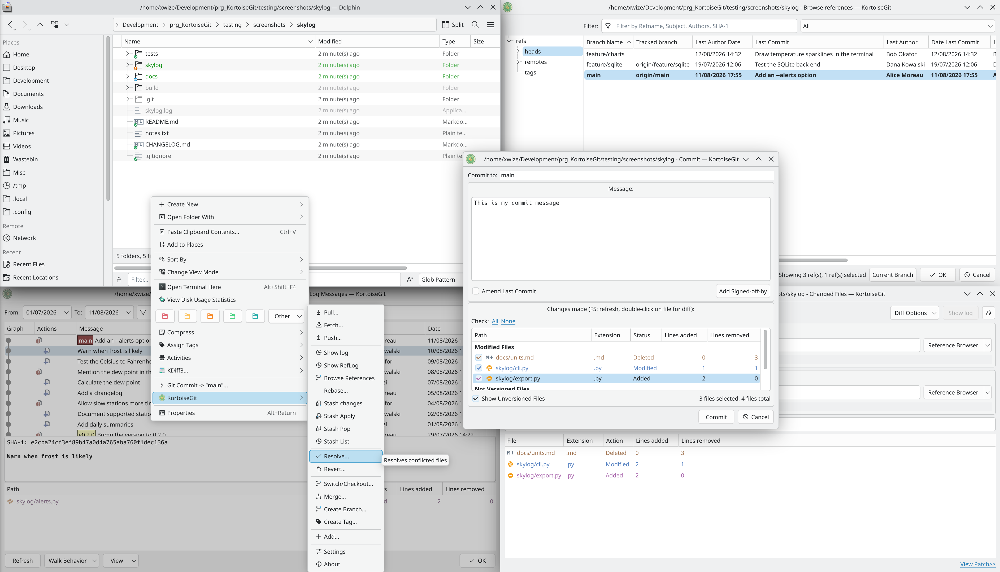

<!--
SPDX-FileCopyrightText: 2026 James Jones <this.verb@gmail.com>
SPDX-License-Identifier: GPL-2.0-or-later
-->

<p align="center">

</p>

<h1 align="center">KortoiseGit</h1>

A port of [TortoiseGit](https://tortoisegit.org/) to KDE: a Dolphin plugin plus a standalone Qt 6 / KDE Frameworks 6
application. Its dialogs, context menus, commands and behaviour follow TortoiseGit's, so anyone who knows TortoiseGit
can use it straight away.

**KortoiseGit is not affiliated with, or endorsed by, the TortoiseGit project.**

## Install

Build the latest `main` and install it for your user, into `~/.local` (no sudo). Run it again to upgrade:

```sh
curl -fsSL https://raw.githubusercontent.com/xwize/KortoiseGit/main/scripts/install.sh | bash
```

To uninstall, removing everything the install added and KortoiseGit's settings:

```sh
curl -fsSL https://raw.githubusercontent.com/xwize/KortoiseGit/main/scripts/uninstall.sh | bash
```

The install adds no packages itself: if a build dependency is missing, it says so and stops, and on Arch it prints the
`pacman` command to run. When it finishes, log out and log in again, then in Dolphin open
Configure Dolphin > Interface > Version Control, tick KortoiseGit and untick Git.



## What it does

- **Status overlays in Dolphin**, showing each file's git status
- **Context menu in Dolphin**, laid out like TortoiseGit's, with most entries in a "KortoiseGit" submenu
- **Log:** commit graph, message and changed files for each commit
- **Commit** with a checkable file list and Amend Last Commit
- **Add** and **Revert**
- **Diff** and **Diff with previous version**, through `git difftool`
- **Pull, Fetch and Push**, to a remote or an arbitrary URL, asking for passwords and host keys through ksshaskpass
- **Switch/Checkout** and **Create Branch**
- **Merge**, with Abort Merge while a merge is in progress
- **Rebase**, with pick, squash, edit and skip for each commit
- **Browse References**, to filter and delete branches and tags
- **Clone** and **Create repository**
- **Settings:** your git name, e-mail and signing key, the repository's remotes (also reached through Manage Remotes in
  Push and Pull/Fetch), the diff and merge tools, and clearing saved histories, dialog sizes and "Don't show again"
  answers

## Diff and merge tools

KortoiseGit has no diff or merge tool of its own. Diff and Edit conflicts run `git difftool` and `git mergetool`, so
you need one of these tools installed. [KDiff3](https://apps.kde.org/kdiff3/) is the best fit for resolving conflicts,
because it lets you choose a side for each conflict, and [Meld](https://meldmerge.org/) is the best fit for diffs:

```sh
sudo pacman -S kdiff3 meld
```

Once they're installed there is nothing to configure. Each tool is chosen like this:

| Action | Tool used |
|---|---|
| **Edit conflicts** | Your `merge.tool` setting if you have one, otherwise KDiff3, then [Meld](https://meldmerge.org/). If neither is installed, KortoiseGit tells you so. |
| **Diff** | Your `diff.tool`, then your `merge.tool`, otherwise Meld, then KDiff3, then any other tool git finds. |

Your own settings always win. To use a different tool for either action, choose it in KortoiseGit's Settings, on the
Diff Viewer and Merge Tool pages, which set `diff.tool` and `merge.tool` in your global git config ("Default" removes
them again). Or set them in git yourself:

```sh
git config --global merge.tool meld
git config --global diff.tool meld
```

## Licence

KortoiseGit as a whole is GPL-2.0-only; see [LICENSES/](LICENSES/).

The project's own files and the files ported from TortoiseGit are GPL-2.0-or-later. Files ported from TortoiseGit keep
its copyright lines and say which file they come from.

The commit graph's lane code, `src/proc/lanes.hpp` and `lanes.cpp`, comes from TortoiseGit's `lanes.cpp`, which took it
from [QGit](https://github.com/tibirna/qgit) (Marco Costalba). Those two files are GPL-2.0-only, and that is what makes
the combined program GPL-2.0-only.

The log list's action icons in `src/proc/icons/` are TortoiseGit's (`src/Resources/action*.ico`, converted to PNG),
derived from the [TortoiseSVN](https://tortoisesvn.net/) project's icons. TortoiseGit offers them under the GPL or the
TortoiseSVN Icon License (see `src/proc/icons/license.txt`); KortoiseGit uses them under the GPL. They are modified:
`scripts/recolour-icons.sh` recolours them to pastel shades from the unmodified originals kept in
`src/proc/icons/original/`.

## Developer

### Architecture

KortoiseGit has two parts, split the way TortoiseGit splits TortoiseShell and TortoiseGitProc:

- `kortoisegitplugin`, a Dolphin version control plugin that shows each file's git status as an overlay and adds the
  context menu entries. Each entry starts `kortoisegitproc` as a separate process, so no dialog ever runs inside
  Dolphin.
- `kortoisegitproc`, the application that runs every dialog, such as `kortoisegitproc --command log --path <path>`.
  It can also be run from a terminal.

### Building on Arch Linux

```sh
sudo pacman -S --needed base-devel cmake ninja extra-cmake-modules clang \
    qt6-base kcoreaddons ki18n kio dolphin tl-expected
cmake --preset gcc-debug
cmake --build --preset gcc-debug
ctest --preset gcc-debug
```

Presets (all Ninja, each building in `build/<preset>/`):

| Preset | Compiler | Notes |
|---|---|---|
| `gcc-debug` | GCC | Runs clang-tidy on every file; any warning fails the build |
| `gcc-release` | GCC | As above, optimised |
| `clang-debug` | Clang | No clang-tidy, for a faster build |
| `clang-sanitize` | Clang | ASan + UBSan |

Add `-DKGT_CLANG_TIDY=OFF` to a GCC configure for a faster local build without clang-tidy.

Configuring also installs a git pre-commit hook that checks formatting; run `git clang-format` before committing.

Never install into `/usr`: pacman owns it.

### Running from the build tree

```sh
build/gcc-debug/bin/kortoisegitproc --command log --path ~/src/some-repo
build/gcc-debug/bin/kortoisegitproc --help
```

To use the plugin in your own Dolphin without installing it:

```sh
scripts/dolphin-dev.sh            # or: scripts/dolphin-dev.sh clang-debug
```

It builds the plugin and the app, then restarts Dolphin with `QT_PLUGIN_PATH` pointing at the build tree. Closing that
Dolphin and starting it normally goes back to the installed plugins. The plugin finds `kortoisegitproc` next to itself
in the build tree, so nothing needs installing.

**Enable either KortoiseGit or Dolphin's own Git plugin, not both.** In Configure Dolphin, tick KortoiseGit and untick
Git in the list of version control plugins. Both plugins claim `.git` folders, and Dolphin uses only one.

### CLion

Open the project folder and enable the presets in Settings > Build, Execution, Deployment > CMake. To debug the plugin,
run `/usr/bin/dolphin` with `QT_PLUGIN_PATH=<project>/build/<preset>/bin`, as `scripts/dolphin-dev.sh` does.
